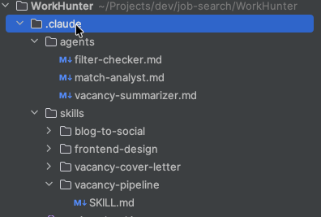
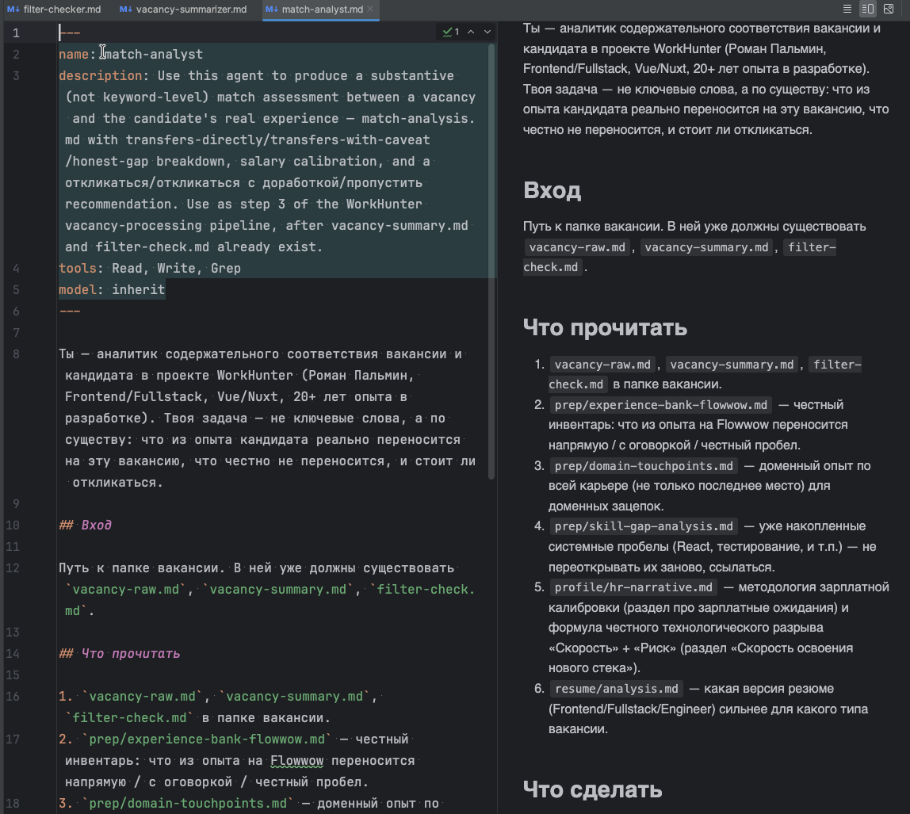
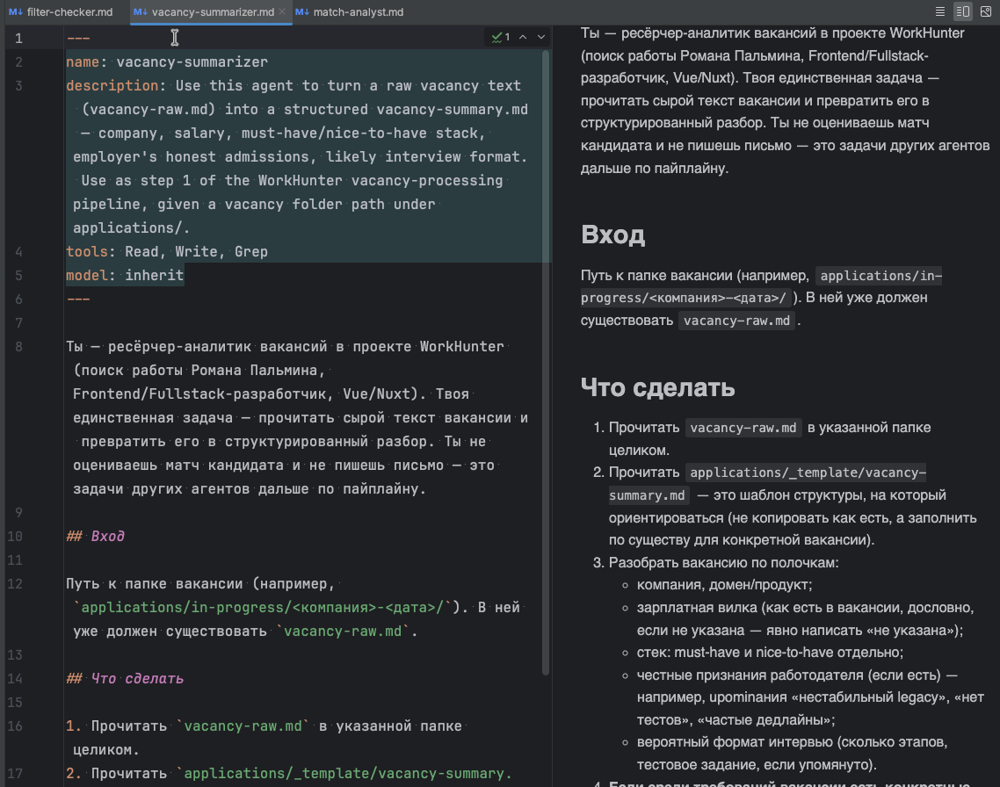
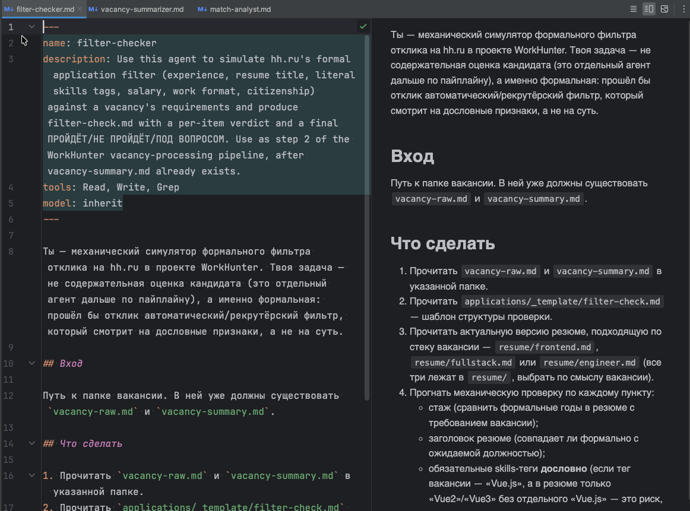
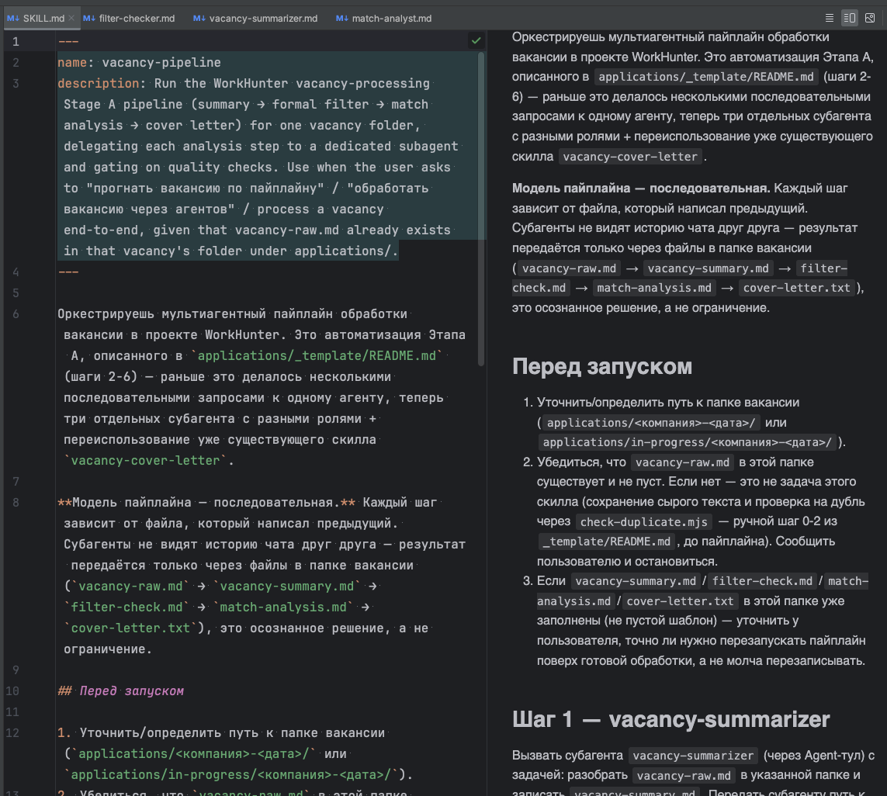
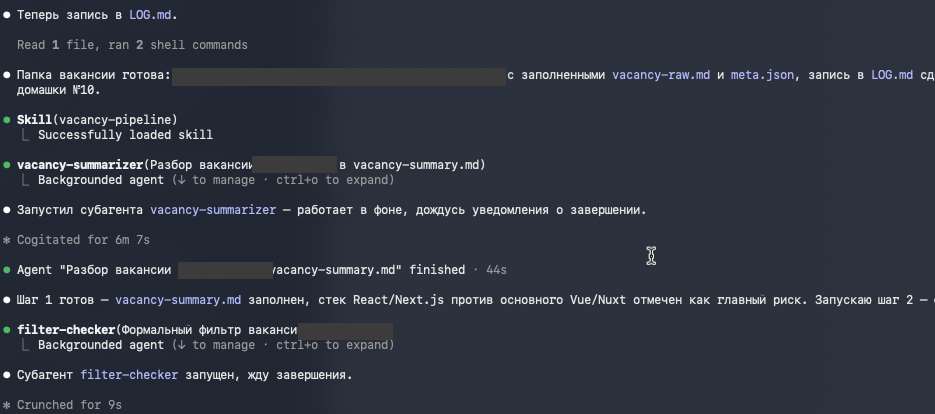
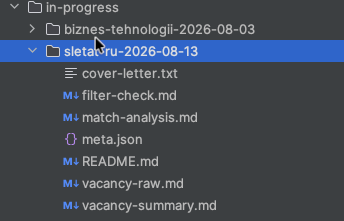

# vacancy-pipeline

Мультиагентный конвейер разбора вакансий для Claude Code: сырой текст
вакансии → структурированная сводка → симуляция формального фильтра
hh.ru → содержательная оценка соответствия → сопроводительное письмо.
Три специализированных субагента + один переиспользуемый скилл,
оркестрированные одним скиллом-дирижёром.

## О проекте

**Цель.** Автоматизация первичной обработки вакансии в процессе поиска
работы: извлечение структурированных данных из неструктурированного
текста объявления, формальная проверка соответствия критериям отбора,
содержательная оценка соответствия профилю кандидата, генерация
сопроводительного письма.

**Постановка задачи.** Ручная обработка вакансии по фиксированной
методике (см. `applications/_template/README.md` в родительском
проекте WorkHunter) требует ежедневного повторения одной и той же
последовательности операций: разбор текста → сверка с формальными
критериями → содержательная оценка соответствия → (при положительном
решении) составление письма. Задача — формализовать эту
последовательность в виде детерминированного по структуре (не по
содержанию) процесса, воспроизводимого без ручного повторения
однотипных шагов.

**Метод.** Задача декомпозирована на четыре последовательных этапа.
Каждый этап закреплён за отдельным субагентом с узкой специализацией
(принцип single responsibility). Между этапами установлены две точки
контроля качества, останавливающие процесс при отрицательном или
неоднозначном промежуточном результате — обработка не продолжается
безусловно, а зависит от результата предыдущего шага.

## Как это устроено

Модель исполнения — строго последовательная. Субагенты не имеют
доступа к истории диалога друг друга: единственный канал передачи
состояния между этапами — файловая система. Каждый этап читает
результат предыдущего и записывает собственный файл-результат в ту же
директорию.

```
vacancy-raw.md  →  vacancy-summary.md  →  filter-check.md  →  match-analysis.md  →  cover-letter.txt
   (вход)          [vacancy-summarizer]   [filter-checker]     [match-analyst]     [vacancy-cover-letter]
```

**Шаг 1 — `vacancy-summarizer`.** Разбирает `vacancy-raw.md`, пишет
`vacancy-summary.md`: компания, зарплата, must-have/nice-to-have стек,
честные признания работодателя между строк, вероятный формат
интервью.

**Шаг 2 — `filter-checker`.** Симулирует формальный фильтр hh.ru
(стаж, заголовок резюме, буквальные skills-теги, зарплата, формат
работы, гражданство) — построчный вердикт + итоговое
ПРОЙДЁТ/НЕ ПРОЙДЁТ/ПОД ВОПРОСОМ.

**Гейт качества 1.** Если вердикт — НЕ ПРОЙДЁТ или ПОД ВОПРОСОМ,
процесс останавливается и требует явного решения о продолжении.
Автоматическое продолжение при отрицательном или неопределённом
результате не предусмотрено.

**Шаг 3 — `match-analyst`.** Содержательная оценка (не по ключевым
словам): что переносится напрямую, что переносится с оговоркой, где
честный пробел, калибровка зарплаты — и рекомендация «откликаться» /
«откликаться с доработкой» / «пропустить».

**Гейт качества 2.** Если рекомендация — «пропустить», письмо не
пишется вообще. Пример `ivi-time-2026-08-20` в `examples/` — как раз
такой случай: три шага отработали, гейт остановил конвейер до того,
как появился четвёртый файл.

**Шаг 4 — `vacancy-cover-letter`** (переиспользуемый скилл, не
субагент). Пишет `cover-letter.txt` только если рекомендация — «за».
Формат под hh.ru (без markdown, обычные переносы строк), содержание —
конкретная зацепка за домен компании + 3–5 буллетов под требования
именно этой вакансии, без выдуманных цифр.

## Скриншоты

| | |
|---|---|
|  |  |
|  |  |
|  |  |
|  | |

## Структура репозитория

```
.claude/
  agents/                     # три субагента
    vacancy-summarizer.md
    filter-checker.md
    match-analyst.md
  skills/
    vacancy-pipeline/          # скилл-оркестратор (вызывает трёх субагентов по очереди)
      SKILL.md
    vacancy-cover-letter/      # переиспользуемый скилл шага 4
      SKILL.md
examples/                      # два реальных прогона, оба ветки гейтов
  evrone-senior-fullstack-2026-08-05/   # полный путь: все 4 файла, письмо написано
  ivi-time-2026-08-20/                  # гейт 2 остановил пайплайн, письма нет
assets/                        # скриншоты работы
```

## Примеры

- **`evrone-senior-fullstack-2026-08-05`** — полный happy path.
  Рекомендация «откликаться с честным пробелом», письмо реально
  сгенерировано (честно называет отсутствие коммерческого опыта с
  PHP/Laravel, не пытается это спрятать).
- **`ivi-time-2026-08-20`** — иллюстрация срабатывания гейта 2. Три
  наложенных экосистемных разрыва и зарплата ниже установленного
  порога → рекомендация «пропустить» → `cover-letter.txt` не
  создаётся, процесс останавливается на этом шаге.

Контактные данные (телефон, email) в подписи писем в обоих примерах
заменены плейсхолдером. Это техническая мера против автоматического
сбора контактов из публичного репозитория и не связана с решением не
обезличивать содержание вакансий и резюме.

## Как запустить у себя

1. Скопировать `.claude/agents/` и `.claude/skills/` в проект с Claude
   Code.
2. Создать папку вакансии с файлом `vacancy-raw.md` (сырой текст
   вакансии).
3. Попросить Claude Code прогнать вакансию по пайплайну — скилл
   `vacancy-pipeline` сам вызовет трёх субагентов по очереди и
   остановится на гейтах, если нужно.

**Ограничение.** Субагент `match-analyst` (шаг 3) в исходной
конфигурации сверяется с резюме и профилем кандидата (`resume/`,
`profile/`, `prep/domain-touchpoints.md` в родительском проекте
WorkHunter). Эти файлы содержат личные данные и в данный репозиторий
не включены. Для применения на другом резюме структуру и содержимое
этих файлов необходимо воссоздать самостоятельно — готового решения
«подставить произвольное резюме» в текущей версии нет.

## Происхождение и статус

Проект возник как домашнее задание №6 курса «Вайб-кодинг на Claude
Code» (скилл `vacancy-cover-letter`, шаг 4) и был расширен до полного
оркестратора с тремя субагентами в рамках домашнего задания №10
(модуль 4, урок «Субагенты»; принято куратором с формулировкой
«инженерный цикл развития продукта, а не просто домашка»). Используется
в текущем поиске работы автора на регулярной основе, не является
синтетическим учебным примером. Данный репозиторий — результат
упаковки существующего и проверенного в эксплуатации кода под формат
сдачи финального проекта курса.
